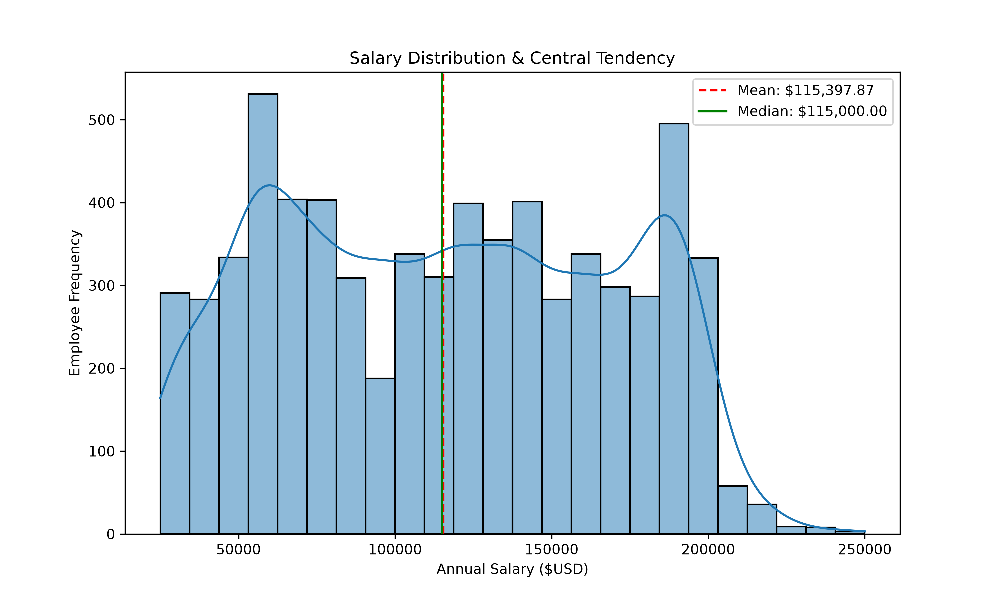
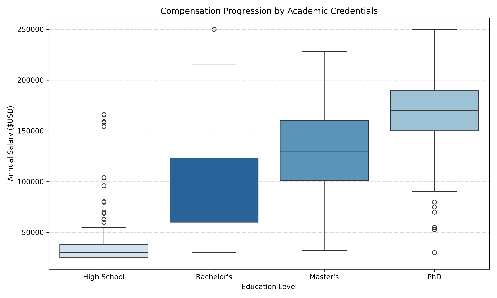
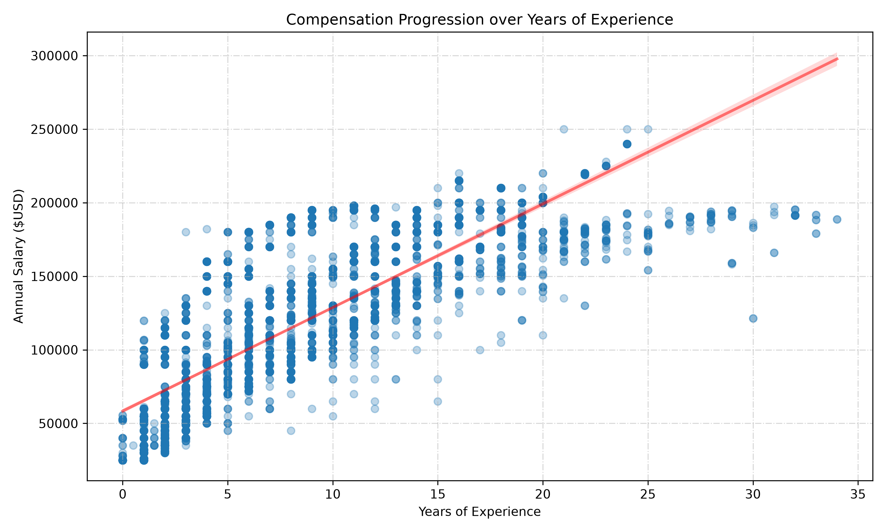

# Compensatio & Carrer Progression Analysis

## 📊 Executive Summary
This project analyzes salary distributions across professional experience tiers and education levels using a cleaned dataset of employment records.

## 📁 Project Architecture 
```text 
large-salary-analysis/ 
├── data/ 
│   ├── clean-salary-data.csv
│   ├── cleaned-salary_data.csv
│   └── Salary_Data.csv
├── scripts/ 
│   ├── __init__.py 
│   ├── eda_visualizations.py
│   ├── main.py 
│   ├── pandas_pipeline.py
│   ├── extract_stats.py 
│   └── generate_readme.py 
├── visualizations/ 
│   ├── salary_distribution.png 
│   ├── education_vs_salary.png 
│   └── experience_vs_salary.png 
├── .gitignore 
├── README.md 
└── requirements.txt
```

## 📈 Key Statistical Findings
### Overall Salary Matrics
| Metric             | Value       |
|:-------------------|:------------|
| Mean Salary        | $115,395.57 |
| Median Salary      | $115,000.00 |
| Standard Deviation | $52,727.24  |
| Minimum Salary     | $25,000.00  |
| Maximum Salary     | $250,000.00 |
| Skewness           | 0.06        |

### Education Level Breakdown
| Education Level   |   count | mean        | median      | std        |
|:------------------|--------:|:------------|:------------|:-----------|
| High School       |     448 | $36,706.69  | $30,000.00  | $22,549.13 |
| Bachelor's        |    3018 | $95,176.96  | $80,000.00  | $44,012.59 |
| Master's          |    1860 | $130,112.06 | $130,000.00 | $40,640.82 |
| PhD               |    1368 | $165,772.12 | $170,000.00 | $34,060.73 |
| NR                |       1 | $100,000.00 | $100,000.00 | N/A        |

### Experience Regression Model
| Metric                  | Value             |
|:------------------------|:------------------|
| Correlation (r)         | 0.8090            |
| Explanatory Power (R²)  | 0.6546            |
| Annual Gain (Slope)     | +$7,039.75 / year |
| Base Salary (Intercept) | $58,382.50        |

## 🖼️ Visualizations

### 1. Overall Salary Distribution


### 2. Salary by Education Level


### 3. Salary vs. Years of Experience


## 🚀 How to Run
1. Clone the repository and install requiriments:
    ```bash
    pip install -r requiriments.txt
    ````
2. Generate data stats and README:
    ```bash
    python scripts/generate_readme.py
    ```